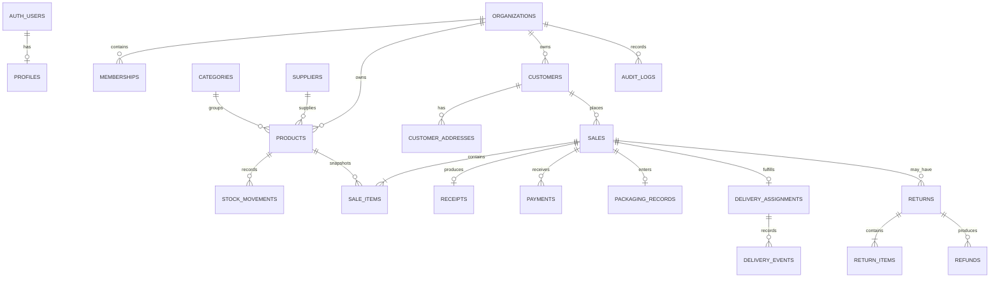

# SAGA Database Architecture

## Scope and migration order

Task 02 creates the PostgreSQL foundation only. It does not create Auth users, passwords, production data, or business RPCs for sales/returns. Apply migrations in lexical order:

1. `001_identity_and_organizations.sql` creates organizations, profiles, memberships, settings, role enums, timestamp maintenance, and authorization helpers.
2. `002_catalog_and_inventory.sql` creates categories, suppliers, products, stock movements, and immutable history protection.
3. `003_customers_and_sales.sql` creates customers, addresses, sellers, sales, sale items, and sale idempotency records.
4. `004_payments_packaging_delivery.sql` creates payments, packaging, and delivery records/events.
5. `005_returns_finance_communications.sql` creates returns, refunds, operational costs, audit logs, and communications.
6. `006_indexes_rls_and_protection.sql` adds query indexes, enables RLS on every application table, and defines role policies.
7. `007_validate_integrity.sql` adds membership, rider-assignment, stock-value, and membership-audit triggers.
8. `008_receipts.sql` adds immutable receipt references and tenant-scoped receipt access.
9. `009_auth_rate_limits.sql` adds the persistent login rate-limit table and atomic function.
10. `010_auth_audit_scope.sql` permits global authentication security events without an organization.
11. `011_authorization_hardening.sql` prevents tenant reparenting and unsafe Rider/membership mutations.
12. `012_rbac_policy_hardening.sql` removes membership deletion and restricts Rider event writes.
13. `013_dashboard_analytics.sql` adds the Admin-only, RLS-aware dashboard aggregation RPC.
14. `014_products_inventory_workflows.sql` adds atomic opening-stock/adjustment/archive RPCs, movement types, SKU normalization, and direct quantity-write guards.
15. `015_product_summary.sql` adds the organization-scoped product summary RPC.
16. `016_customer_management.sql` adds notes, richer address/consent fields, customer creation/list RPCs, and default-address support.
17. `017_customer_summary.sql` adds numeric customer total and organization metrics RPCs.
18. `018_suppliers_sellers_management.sql` adds supplier/seller fields, Admin-only aggregation RPCs, and archived-supplier assignment protection.
19. `019_sales_transaction.sql` adds atomic sale creation, concurrent idempotency, receipt sequencing, stock deductions, payment/receipt/packaging writes, and direct-mutation guards.
20. `020_sales_history.sql` adds sales-history indexes and RPCs for filtered pagination plus payment-safe summary aggregation.
21. `021_fulfillment_workflows.sql` adds idempotent packaging/delivery/payment RPCs, fulfillment indexes, and RPC-only write policies.
22. `022_returns_refunds.sql` adds Moderator return policy, return idempotency, atomic stock/refund RPC, sequence state, and RPC-only return writes.
23. `023_communications.sql` adds communication templates, recipient/provider fields, send idempotency indexes, and persistent rate limits.
24. `024_communications_dispatch.sql` adds queued send reservation/completion RPCs.
25. `025_settings_admin_audit.sql` adds organization and receipt settings, Rider eligibility enforcement, immutable categorized audit snapshots, and Admin-only settings/member/audit RPCs.

## Entity relationships

All tenant-owned tables carry `organization_id`. Relationships between tenant-owned records use composite foreign keys such as `(organization_id, product_id)`, preventing cross-organization references even when IDs are supplied directly.

## Money, inventory, and history

Money uses `numeric(18,2)` and quantity uses `numeric(18,3)`. Products reject negative quantity/prices. Payments and refunds must be positive. Sale, return, payment, and delivery workflows remain future transaction/RPC boundaries; the schema stores snapshots and idempotency keys so those operations can be atomic and retry-safe when implemented.

Stock movements store before/after quantities, actor, reason, operation type, and reference. Update/delete triggers reject mutation. Audit logs and event tables preserve operational history. Product/customer/category records use active/archive flags rather than requiring destructive deletion.

## Authorization and RLS

Every application table has RLS enabled. Anonymous requests have no policies. Authorization helpers are `SECURITY DEFINER`, use a fixed `search_path`, read `auth.uid()`, and check active memberships from trusted database state. They are executable only by `authenticated`.

- Admin: organization-wide access, administration, finance, returns, audit reads, and settings.
- Moderator: products/inventory, customers, sales, packaging, and delivery operations.
- Rider: only assigned delivery records/events and allowed progress updates.
- Supplier, seller, communications, settings, costs, refunds, and audit reads are Admin-only.

The database does not trust browser-supplied role or organization claims. Rider assignment validation checks an active Rider membership in the same organization. Membership role changes are guarded and audited.

## Index strategy

Indexes cover active memberships by user, tenant/status filters, product/category and stock history, sales chronology/status, sale items, payments by sale, rider delivery queues, and audit entity history. Unique constraints cover tenant SKU, receipt number, idempotency keys, one default address, and one delivery/packaging record per sale.

## Tests and application

`supabase/tests/database_foundation.sql` is a pgTAP smoke suite for table existence, keys, checks, and representative RLS enablement. Run it in Supabase SQL editor or a local Supabase test database with pgTAP available. Full authenticated RLS tests require actual Supabase Auth identities and a staging project; they are not falsely claimed as locally executed here.

Apply with the Supabase CLI in a disposable local/staging project, then run `supabase db test`. Never reset or apply these migrations to production without explicit approval and a backup/rollback plan. `supabase/seed.sql` contains synthetic development records only and creates no privileged Auth users.

## Decisions requiring confirmation

The schema leaves accounting journal tables, provider credentials, configurable role exceptions, and the complete atomic sale/return/payment RPCs for later tasks. Business owners must confirm currency, timezone, payment methods, return approval policy, and whether operational costs belong in the first accounting release before those contracts are finalized.
